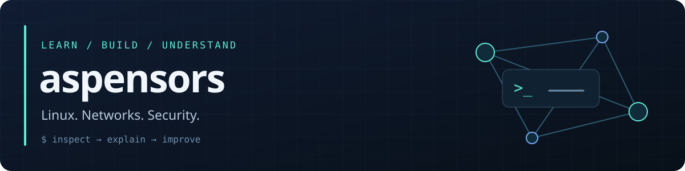

  
  
  

### Привет, я aspensors

Учусь на первом курсе колледжа по направлению «Информационная безопасность». Моя основная ОС — **Arch Linux**. Развиваю проекты на Python, изучаю сети и безопасность Linux через практику.

Мне интересны инструменты, которые помогают разобраться в проблеме: показывают наблюдения, объясняют результат и честно обозначают ограничения.

### Проекты

| Проект | Что делает |
| :--- | :--- |
| **[arch-security-audit](https://github.com/aspensors/arch-security-audit)** | Проверки настроек Linux: nftables, SSH, обновления, привилегии и SUID/SGID. Объяснения, JSON, деморежим и автоматические тесты. |
| **[net-diag](https://github.com/aspensors/net-diag)** | Диагностика DNS, TCP, TLS/SNI и HTTPS. Консольный и графический интерфейсы, отчёты JSON и пояснения к результатам. |

### Сейчас разбираюсь

- **Linux:** права доступа, службы и конфигурация системы.
- **Сети:** DNS, соединения TCP и поведение TLS/HTTPS.
- **Разработка:** понятные CLI, обработка ошибок, тесты и документация.

### Как работаю над проектами

Собираю факты → разбираю ограничения → проверяю результат → описываю, как его воспроизвести.

Предложения по улучшению и сообщения об ошибках можно оставлять в Issues соответствующего проекта. Личные данные и реальные конфиги перед публикацией лучше обезличивать.

---

Information security student · Arch Linux user · Building tools for Linux and network diagnostics

